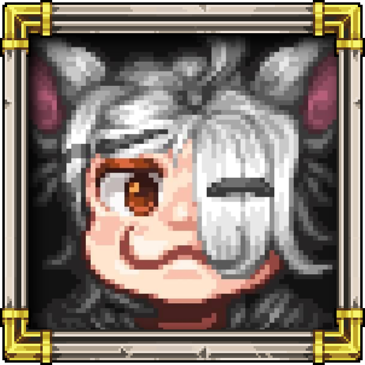

# Pixivic's Portfolio

A responsive, multi-page HTML/CSS/JavaScript portfolio baseline.

## Open it locally

### Easy method
Double-click `index.html`.

### Recommended method
1. Open this folder in Visual Studio Code.
2. Install the **Live Server** extension.
3. Right-click `index.html`.
4. Select **Open with Live Server**.

## Add your profile picture

1. Put your image inside:
   `assets/images/`
2. Name it `profile.png`.
3. Open `index.html`.
4. Find the `profile-frame` section.
5. Remove the placeholder `<div>`.
6. Uncomment or add:

```html

```

## Install Alagard and Pixel Operator

The design is configured for:

- `assets/fonts/alagard.ttf`
- `assets/fonts/PixelOperator.ttf`
- `assets/fonts/PixelOperator-Bold.ttf`

Put those three files inside `assets/fonts/`.

Typography assignment:

- **Alagard:** titles, navigation, buttons, and main interface text
- **Pixel Operator:** subtitles, introductions, descriptions, and supporting text

The required `@font-face` rules are already included in `assets/css/style.css`.

## Add artwork

Put images inside `assets/images/`, then replace a placeholder such as:

```html
<div class="project-preview">ARTWORK PLACEHOLDER 1</div>
```

with:

```html
<div class="project-preview">
    
</div>
```

## Add a YouTube trailer

Replace a video placeholder with:

```html
<iframe
    width="100%"
    height="100%"
    src="https://www.youtube.com/embed/VIDEO_ID"
    title="Game trailer"
    allowfullscreen>
</iframe>
```

## GitHub Pages compatibility

All links use relative paths, so the site can later be uploaded to GitHub Pages without changing the folder structure.

When ready:
1. Create a GitHub repository.
2. Upload everything inside this folder.
3. Open repository **Settings → Pages**.
4. Choose **Deploy from a branch**.
5. Select `main` and `/root`.
6. Save.


## Sharper pixel-font rendering

This version uses `PixelOperator8.ttf` and `PixelOperator8-Bold.ttf` for subtitles and descriptions.

The CSS also:

- uses whole-pixel font sizes instead of fractional responsive sizes
- removes blurred glow from headings
- uses a hard-edged title shadow
- requests reduced browser font smoothing

Browsers may still apply a small amount of anti-aliasing, especially when the page is zoomed above or below 100%. For the cleanest result, view the site at 100% browser zoom.


## Pixel Art category pages

- `pixel-boss-sprites.html` — Boss Sprites
- `pixel-item-icons.html` — Item Icons
- `pixel-npc-sprites.html` — NPC Sprites
- `pixel-ui-assets.html` — UI Assets
- `pixel-game-cosmetics.html` — Game Cosmetics
- `pixel-environment-tilesets.html` — Environment & Tilesets
- `pixel-title-icon-logos.html` — Title & Icon Logos


## Custom artwork update

- `assets/images/profile.png` is used as the homepage profile portrait.
- `assets/images/portfolio-background.png` is used as the scrolling page background.
- `assets/images/category-container.png` frames the Pixel Art, Digital Art, and Concept Art buttons.
- Game Trailer has been removed from the homepage, navigation, and project files.


## Cleanup update

Removed:
- “Game Trailers” from the homepage specialization text
- the `PX` icon from the Title & Icon Logos card
- the Soft Blue theme-toggle button from all pages


## Boss gallery update

- Removed the **Title & Icon Logos** category and its HTML page.
- Added seven supplied boss artworks to `pixel-boss-sprites.html`.
- Bosses are displayed five per row on large screens.
- Each boss uses the supplied gold/brown container image.
- The container has no title or description inside it.
- **More Details** and **Pricing** buttons appear below each boss.
- The buttons currently open editable placeholder popups.


## Boss gallery correction

- Removed the separate More Details and Pricing buttons under every boss.
- Added one editable More Details and Pricing text section below the complete boss gallery.
- The actual animated GIF files remain animated through normal `` tags.
- `Giant Skeleton Boss.gif` and `nydaraxboss.gif` were static PNG images with misleading `.gif` filenames, so they were renamed to `.png`.


## Boss artwork lightbox

- Click any boss container to open the artwork in a large fullscreen preview.
- Click the fullscreen preview again to close it.
- The Escape key also closes the preview.


## Expanded boss gallery

- Added all newly supplied boss artworks and avoided duplicate entries.
- The desktop gallery remains five items per row.
- Clicking a boss opens a moderately sized preview inside the supplied gold/brown container.
- Clicking the enlarged preview again closes it.
- Removed the “or editing a trailer” line from the homepage introduction.


## Pixel Art category button update

- Uses `assets/images/boss-category-button.png` for the Boss Sprites category.
- Displays each category title along the bottom of its image button.
- Uses the empty gold/brown container for the remaining Pixel Art categories.
- All category images remain clickable.


## Yeti scale adjustment

The Yeti Boss sprite is displayed at 78% inside its gallery container so its visible size matches the other boss artworks more closely.


## Boss GIF restoration

Replaced boss image files with the originals extracted from `Bosses.zip` to preserve animation frames where available.


## Boss information button update

- Added “Boss Sprites Examples” below the Boss Sprites page title.
- Replaced the separate More Details and Pricing blocks with one large “More Info & Pricing” button.


## Boss information container update

- Replaced the More Info & Pricing button with one information container.
- Added editable example text about boss sprite inclusions and pricing.


## Item Icons page update

- Added a single scrollable showcase container for the uploaded item icon sheet.
- Added drop shadow styling to the item sheet.
- Added a separate More Info & Pricing container below the showcase.


## Item Icons button and new boss update

- Updated the Pixel Art page so the Item Icons category uses the uploaded custom button image.
- Added the uploaded scarab-style boss sprite to the Boss Sprites gallery.


## Cogfather and Bee Mech update

- Replaced Bee Mech Boss with the newly uploaded file.
- Added Cogfather Boss to the Boss Sprites gallery as the first entry.
- Moved Bee Mech Boss beside Scarab Boss in the gallery order.


## NPC gallery update

- Added the uploaded NPC sprites into the NPC Sprites section using the same framed presentation as the Boss Sprites page.
- NPC gallery uses the same click-to-view preview behavior.
- Added the new antler skull boss to the Boss Sprites gallery.
- Updated the Item Icons button image and item sheet image to the latest uploaded versions.


## NPC uniform grid fix

- Updated the NPC Sprites page so all NPC cards use a uniform square box layout.
- Kept the gallery at 5 columns on desktop so the full set lays out across about 10 rows.


## NPC cleanup update

- Replaced the Malice Pillar NPC GIF with the newly uploaded version.
- Removed Valentine Mr Cheese from the NPC gallery.


## Additional NPC update

- Added the latest uploaded NPC set to the NPC gallery page.

- Added one more uploaded NPC to the NPC gallery.


## UI Assets page

- Added 9 UI asset examples in one vertically scrollable column.
- Added 6 UI screenshots in a separate vertically scrollable column.
- Both sections use framed containers and drop shadows.


## UI information section

- Added a separate More Info & Pricing panel below the UI Assets and UI Screenshots boxes.


## Cosmetics gallery update

- Removed `cosm21.png`.
- Shuffled the Armors, Weapons, & Cosmetics gallery into a mixed order instead of numeric order.


## Armors category button update

- Replaced the Armors, Weapons, & Cosmetics category image with the newly supplied button artwork.
- Reduced only this category title's font size so it fits in one or two lines.


## Preview box update

- Cosmetics now open inside a plain bordered preview box instead of the boss artwork frame.
- Tiles and environment images now open in an on-page preview overlay. Click or tap the preview again to close it.


## Cosmetics preview frame correction

- Restored the original gold asset frame in the large preview.
- Locked the preview to the frame's original aspect ratio so it no longer stretches or reshapes.
- The full frame now scales down to fit within the screen while the PNG or GIF stays contained inside it.


## Socials and temporary page update

- Removed the Explore My Work button.
- Added the new profile-description sentence.
- Replaced Digital Art and Concept Art page content with Coming Soon.
- Removed More Info & Pricing from every Pixel Art category page.
- Added Socials & Contacts sections to the profile and all Pixel Art category pages.
- Discord opens a same-page username window; Instagram, YouTube, and Email use their requested links/actions.


## Floating social buttons update

- Replaced the Instagram placeholder with the uploaded Instagram button.
- Removed the bordered social container so the icons float directly over the page.
- Reduced the social title, icons, and labels.
- Highlighted the phrase “highly adaptive” in the profile description.
